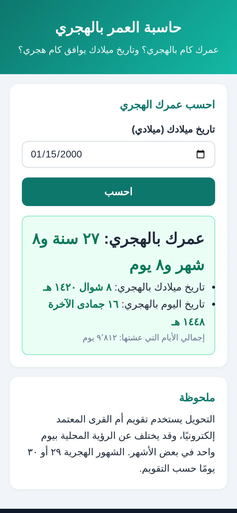

# Hijri Age Calculator | حاسبة العمر بالهجري

Convert your Gregorian birthdate to its Hijri equivalent (Umm al-Qura calendar) and see your age in Hijri years, months and days, plus today's Hijri date. Arabic interface.

**Live app:** https://abood-ayman.github.io/age-hijri-ar/

**LinkedIn:** [Project entry](https://www.linkedin.com/in/abdullah-ayman-1678b737b/details/projects/)

This is a personal project, built with AI tools.

## Features
- Hijri birthdate from your Gregorian one (Umm al-Qura)
- Exact age in Hijri years, months and days (Hijri months counted as 29 or 30 days per the calendar)
- Today's Hijri date
- Total days you have lived

## Note
The conversion uses the electronic Umm al-Qura calendar and can differ from local moon sighting by one day in some months.

## Privacy
Everything runs in your browser. No data is stored or sent anywhere.

## Run locally
Open `index.html` in any browser. It is a single static page with no dependencies.

## Status
Stable.

## Copyright
MIT License - Copyright (c) 2026 Abdullah Ayman.
